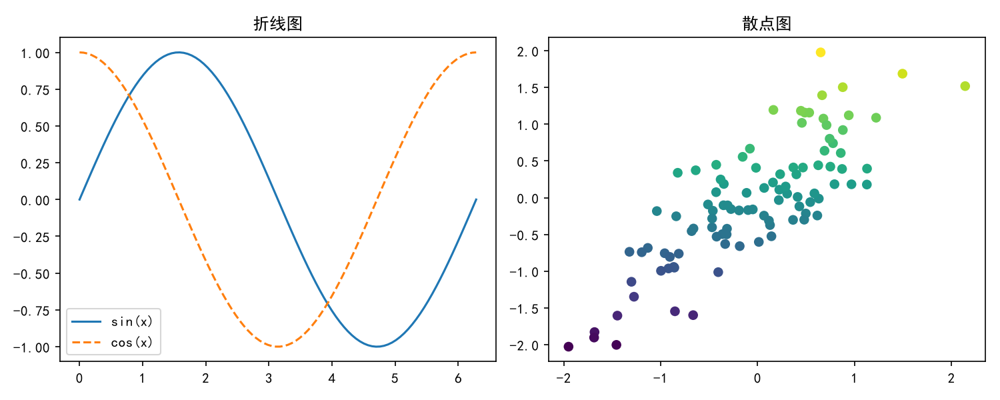
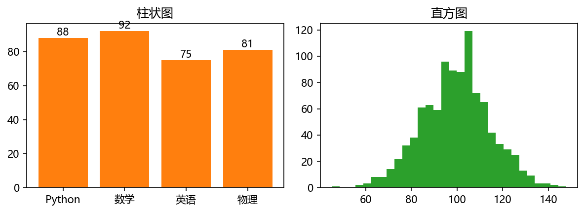
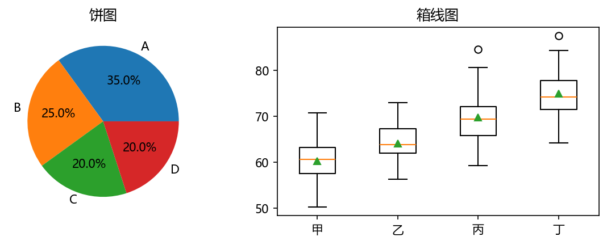
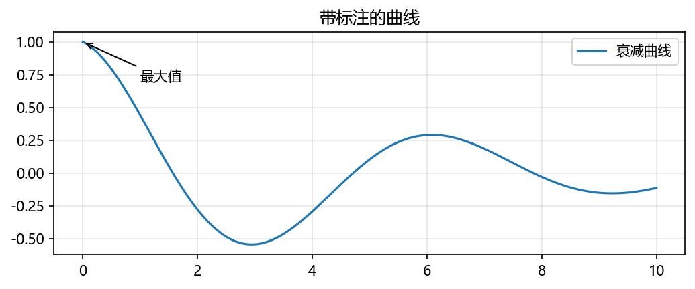

# 实验报告：NumPy、Pandas、Matplotlib 常用方法总结与验证

---

## 一、实验目的

1. 系统梳理科学计算与数据分析中最常用的三个第三方库的核心方法；
2. 通过可运行的 Python 代码逐一验证各方法的语法与输出结果；
3. 掌握"数组计算（NumPy）→ 表格数据处理（Pandas）→ 可视化（Matplotlib）"的完整数据分析流程。

---

## 二、NumPy 常用方法总结

NumPy 提供 `ndarray`（N 维数组）对象，是 Python 科学计算的基础，其核心特点是**向量化运算**和**广播机制**，避免了 Python 循环带来的性能开销。

### 2.1 方法分类总结

| 分类 | 常用方法 | 说明 |
| --- | --- | --- |
| 数组创建 | `np.array` / `np.zeros` / `np.ones` / `np.eye` | 从列表创建、全 0、全 1、单位矩阵 |
| | `np.arange(start, stop, step)` | 等差序列（按步长） |
| | `np.linspace(start, stop, num)` | 等分序列（按个数） |
| | `rng.random` / `rng.normal` | 均匀分布 / 正态分布随机数 |
| 属性 | `shape` / `ndim` / `size` / `dtype` | 形状、维度、元素个数、数据类型 |
| 变形 | `reshape` | 不改变数据的前提下修改形状 |
| 索引切片 | `m[i, j]`、`m[0, :]`、`m[:, 1]` | 多维下标、整行、整列 |
| | 布尔索引 `m[m > 7]` | 条件筛选元素 |
| | 花式索引 `m[[0, 2]]` | 用下标列表取多行 |
| 运算 | `+ - * /`、`np.dot` | 逐元素运算、矩阵点积 |
| | `np.sqrt` / `np.exp` | 通用函数（ufunc） |
| | 广播 | 形状不同的数组间自动对齐运算 |
| 统计 | `max` / `min` / `mean` / `std` / `argmax` / `argmin` | 统计值与极值位置 |
| 线性代数 | `T`、`np.linalg.inv / det / eigvals` | 转置、逆矩阵、行列式、特征值 |
| 合并拆分 | `vstack` / `hstack` / `concatenate` / `split` | 垂直堆叠、水平拼接、拼接、拆分 |

### 2.2 验证代码（demo_numpy.py）

```python
import numpy as np

# 1. 数组创建
a = np.array([1, 2, 3, 4, 5])        # 从列表创建
z = np.zeros((2, 3))                 # 全 0
o = np.ones((2, 2))                  # 全 1
e = np.eye(3)                        # 单位矩阵
r = np.arange(0, 10, 2)              # [0 2 4 6 8]
l = np.linspace(0, 1, 5)             # [0. 0.25 0.5 0.75 1.]
rng = np.random.default_rng(42)      # 随机数生成器（固定种子可复现）
rand = rng.random((2, 3))            # [0,1) 均匀分布
n = rng.normal(0, 1, 5)              # 标准正态分布

# 2. 属性与变形
m = np.arange(12).reshape(3, 4)      # reshape 变形为 3 行 4 列
print(m.shape, m.ndim, m.size, m.dtype)   # (3,4) 2 12 int32

# 3. 索引与切片
m[1, 2]          # 单元素   -> 6
m[0, :]          # 第 0 行  -> [0 1 2 3]
m[:, 1]          # 第 1 列  -> [1 5 9]
m[m > 7]         # 布尔索引 -> [8 9 10 11]
m[[0, 2]]        # 花式索引 -> 第 0、2 行

# 4. 运算与广播
x = np.array([1, 2, 3]); y = np.array([4, 5, 6])
x + y            # [5 7 9]  逐元素加
x * y            # [4 10 18] 逐元素乘
np.dot(x, y)     # 32 点积
x + 10           # [11 12 13] 标量广播
np.arange(3).reshape(3, 1) + np.arange(3)   # (3,1)+(3,) 广播成 (3,3)
np.max(x), np.mean(x), np.std(x), np.argmax(x)

# 5. 线性代数
M = np.array([[1, 2], [3, 4]])
M.T                         # 转置
np.linalg.inv(M)            # 逆矩阵
np.linalg.det(M)            # 行列式 -> -2.0
np.linalg.eigvals(M)        # 特征值

# 6. 合并与拆分
np.vstack([x, y])           # 垂直堆叠成 2x3
np.hstack([x, y])           # 水平拼接成 1x6
np.split(r, 5)              # 等分拆分
```

### 2.3 运行结果（节选，实际已完整验证）

```text
np.array([1,2,3,4,5])       -> [1 2 3 4 5]
np.arange(0,10,2)           -> [0 2 4 6 8]
np.linspace(0,1,5)          -> [0.   0.25 0.5  0.75 1.  ]
m.shape (形状)      -> (3, 4)    m.ndim -> 2    m.size -> 12
m[1, 2]     -> 6
m[:, 1]     -> [1 5 9]
m[m > 7]    -> [ 8  9 10 11]
x + y       -> [5 7 9]
np.dot(x, y)-> 32
广播 (3,1)+(3,) -> [[0 1 2] [1 2 3] [2 3 4]]
np.linalg.inv(M) -> [[-2. 1.] [1.5 -0.5]]
np.linalg.det(M) -> -2.0000000000000004
np.linalg.eigvals(M) -> [-0.372  5.372]
np.vstack([x, y]) -> [[1 2 3] [4 5 6]]

NumPy 全部验证通过 ✔
```

---

## 三、Pandas 常用方法总结

Pandas 在 NumPy 之上提供 `Series`（一维带标签序列）和 `DataFrame`（二维表格）两种结构，是数据清洗与分析的主力工具。

### 3.1 方法分类总结

| 分类 | 常用方法 | 说明 |
| --- | --- | --- |
| 数据结构 | `pd.Series` / `pd.DataFrame` | 一维序列 / 二维表格 |
| 查看数据 | `head` / `tail` / `shape` / `columns` / `dtypes` | 前后若干行、形状、列名、类型 |
| | `info()` / `describe()` | 结构概览 / 数值列统计摘要 |
| 选择数据 | `df['列名']`、`df[['列1','列2']]` | 取单列 / 多列 |
| | `loc[行, 列]` / `iloc[i, j]` | 按标签 / 按位置索引 |
| | `df[条件]` / `query()` | 布尔筛选 / 表达式筛选 |
| 增删改 | 新增列、`apply`、`drop(columns=)`、`drop(index=)`、`loc` 赋值 | 加工数据的常规操作 |
| 缺失值 | `isna()` / `isna().sum()` | 判断缺失、统计缺失数 |
| | `fillna()` / `dropna()` | 填充 / 删除缺失 |
| 分组聚合 | `groupby()` + `mean/count/max`、`agg()` | 分组统计、多聚合命名聚合 |
| | `value_counts()` | 频数统计 |
| 排序去重 | `sort_values()` / `sort_index()` / `drop_duplicates()` | 排序与去重 |
| 合并 | `merge(on=, how=)` / `concat()` | 表连接（类 SQL JOIN）/ 拼接 |
| 透视与时间 | `pivot_table()` / `date_range()` / `resample()` | 透视表 / 时间索引 / 重采样 |
| 文件读写 | `to_csv` / `read_csv` / `to_excel` / `read_excel` | CSV、Excel 互转 |

### 3.2 验证代码（demo_pandas.py）

```python
import pandas as pd
import numpy as np

# 1. 核心数据结构
s = pd.Series([10, 20, 30, 40], index=["a", "b", "c", "d"], name="销量")
df = pd.DataFrame({
    "姓名": ["张三", "李四", "王五", "赵六", "钱七"],
    "性别": ["男", "女", "男", "女", "男"],
    "年龄": [23, 21, 25, 22, 24],
    "成绩": [88, 92, 75, 95, 81],
})

# 2. 查看数据
df.head(3); df.tail(2)
df.shape          # (5, 4)
df.info(); df.describe()

# 3. 选择数据
df["姓名"]                          # 取单列
df.loc[0, "姓名"]                   # 按标签 -> 张三
df.iloc[0, 3]                       # 按位置 -> 88
df[df["成绩"] >= 85]                # 条件筛选
df[(df["性别"] == "男") & (df["成绩"] > 80)]   # 多条件
df.query("年龄 >= 23")              # 表达式筛选

# 4. 增删改
df2 = df.copy()
df2["等第"] = df2["成绩"].apply(lambda x: "优秀" if x >= 85 else "良好")
df2 = df2.drop(columns=["等第"]).drop(index=4)
df2.loc[df2["姓名"] == "李四", "成绩"] = 98

# 5. 缺失值处理
df3 = pd.DataFrame({"A": [1, np.nan, 3, None], "B": [5, 6, np.nan, 8]})
df3.isna().sum()                    # 每列缺失数
df3.fillna(0)                       # 0 填充
df3["A"].fillna(df3["A"].mean())    # 均值填充
df3.dropna()                        # 删除含缺失的行

# 6. 分组聚合
df.groupby("性别")["成绩"].mean()
df.groupby("性别").agg(人数=("成绩", "count"), 平均分=("成绩", "mean"),
                       最高分=("成绩", "max"))
df["成绩"].value_counts()

# 7. 排序与去重
df.sort_values("成绩", ascending=False)
dup.drop_duplicates()

# 8. 合并拼接
pd.merge(info, score, on="姓名", how="inner")   # 表连接
pd.concat([info, info], ignore_index=True)      # 纵向拼接

# 9. 透视表与时间序列
pd.pivot_table(df, index="性别", values="成绩", aggfunc="mean")
ts = pd.date_range("2026-01-01", periods=5, freq="D")
tsdf.resample("ME", on="日期")["销量"].sum()     # 按月重采样求和

# 10. 文件读写
df.to_csv("demo_df.csv", index=False, encoding="utf-8-sig")
pd.read_csv("demo_df.csv")
df.to_excel("demo_df.xlsx", index=False)
```

### 3.3 运行结果（节选，实际已完整验证）

```text
df.shape  -> (5, 4)

df.describe():
             年龄       成绩
mean   23.000000  86.200000
std     1.581139   8.167007
min    21.000000  75.000000
max    25.000000  95.000000

df[df['成绩'] >= 85]:
    姓名 性别  年龄  成绩
0  张三   男    23    88
1  李四   女    21    92
3  赵六   女    22    95

df.groupby('性别').agg(...):
       人数     平均分  最高分
女       2  93.500000      95
男       3  81.333333      88

df3.isna().sum():  A -> 2, B -> 1
df3['A'].fillna(mean): 0 -> 1.0, 1 -> 2.0, 2 -> 3.0, 3 -> 2.0

pd.merge(info, score, on='姓名'):
    姓名 班级  成绩
0  张三  1班    88
1  李四  1班    92
2  王五  2班    75

tsdf.resample('ME', on='日期')['销量'].sum():
2026-01-31    79

文件读写: demo_df.csv / demo_df.xlsx 已生成，read_csv 读回 shape = (5, 4)
Pandas 全部验证通过 ✔
```

---

## 四、Matplotlib 常用方法总结

Matplotlib 是 Python 最经典的绑图库，本实验采用官方推荐的**面向对象方式**（`fig, ax = plt.subplots()` 或 `fig.add_subplot()`），并演示了 6 类最常用图表。

### 4.1 方法分类总结

| 分类 | 常用方法 | 说明 |
| --- | --- | --- |
| 全局设置 | `plt.rcParams["font.sans-serif"] = ["SimHei"]` | 设置中文字体，避免中文乱码 |
| | `plt.rcParams["axes.unicode_minus"] = False` | 正常显示负号 |
| 画布与子图 | `plt.figure(figsize=)` | 创建画布，指定尺寸 |
| | `fig.add_subplot(2, 3, 1)` | 网格方式添加子图 |
| | `plt.subplots()` | 一次性创建画布+子图 |
| 基础图表 | `ax.plot(x, y, color=, ls=, lw=, label=)` | 折线图 |
| | `ax.scatter(x, y, c=, s=, cmap=, alpha=)` | 散点图（支持颜色映射） |
| | `ax.bar(x, h, width=, yerr=)` + `bar_label` | 柱状图（误差棒、数值标签） |
| | `ax.hist(data, bins=, density=)` | 直方图 |
| | `ax.pie(sizes, labels=, autopct=, explode=)` | 饼图（百分比、突出块） |
| | `ax.boxplot(data, tick_labels=)` | 箱线图（3.9+ 用 `tick_labels`） |
| 坐标轴 | `set_title` / `set_xlabel` / `set_ylabel` / `set_xlim` / `set_ylim` | 标题、轴标签、坐标范围 |
| 辅助元素 | `legend()` / `grid()` / `colorbar()` / `axvline()` | 图例、网格、颜色条、参考线 |
| | `annotate()` / `text()` | 带箭头标注 / 自由文本 |
| 输出 | `fig.tight_layout()` / `fig.savefig(fname, dpi=)` | 自动排版 / 保存图片 |

### 4.2 验证代码（demo_matplotlib.py）

```python
import numpy as np
import matplotlib
matplotlib.use("Agg")            # 非交互后端：保存文件而非弹窗
import matplotlib.pyplot as plt

# 中文字体设置（否则中文显示为方框）
plt.rcParams["font.sans-serif"] = ["SimHei", "Microsoft YaHei"]
plt.rcParams["axes.unicode_minus"] = False

rng = np.random.default_rng(42)
fig = plt.figure(figsize=(12, 9))          # 创建画布
fig.suptitle("Matplotlib 常用图表验证", fontsize=16)

# 1. 折线图 plot：颜色/线型/线宽/图例/网格
ax1 = fig.add_subplot(2, 3, 1)
x = np.linspace(0, 2 * np.pi, 100)
ax1.plot(x, np.sin(x), color="tab:blue", lw=2, ls="-", label="sin(x)")
ax1.plot(x, np.cos(x), color="tab:red", lw=2, ls="--", label="cos(x)")
ax1.set_title("折线图 plot"); ax1.set_xlabel("x"); ax1.set_ylabel("y")
ax1.legend(); ax1.grid(alpha=0.4)

# 2. 散点图 scatter：颜色映射 + 颜色条
ax2 = fig.add_subplot(2, 3, 2)
xs = rng.normal(0, 1, 100); ys = 0.8 * xs + rng.normal(0, 0.5, 100)
sc = ax2.scatter(xs, ys, c=ys, cmap="viridis", s=30, alpha=0.8)
fig.colorbar(sc, ax=ax2); ax2.set_title("散点图 scatter")

# 3. 柱状图 bar：误差棒 + 柱顶数值标签
ax3 = fig.add_subplot(2, 3, 3)
bars = ax3.bar(["Python", "数学", "英语", "物理"], [88, 92, 75, 81],
               color="tab:orange", yerr=[2, 1, 3, 2], capsize=4)
ax3.bar_label(bars, fmt="%d", padding=2)
ax3.set_ylim(0, 105); ax3.set_title("柱状图 bar")

# 4. 直方图 hist：密度归一 + 均值参考线
ax4 = fig.add_subplot(2, 3, 4)
data = rng.normal(100, 15, 1000)
ax4.hist(data, bins=30, density=True, color="tab:green", alpha=0.8)
ax4.axvline(data.mean(), color="red", ls="--", label=f"均值={data.mean():.1f}")
ax4.legend(); ax4.set_title("直方图 hist")

# 5. 饼图 pie：百分比 + 突出块
ax5 = fig.add_subplot(2, 3, 5)
ax5.pie([35, 25, 20, 20], labels=["A 类", "B 类", "C 类", "D 类"],
        autopct="%.1f%%", explode=[0.08, 0, 0, 0], startangle=90, shadow=True)
ax5.set_title("饼图 pie"); ax5.axis("equal")

# 6. 箱线图 boxplot（matplotlib 3.9+ 使用 tick_labels）
ax6 = fig.add_subplot(2, 3, 6)
groups = [rng.normal(m, 5, 60) for m in (60, 65, 70, 75)]
bp = ax6.boxplot(groups, tick_labels=["甲", "乙", "丙", "丁"],
                 patch_artist=True, showmeans=True)
for p in bp["boxes"]:
    p.set_facecolor("lightblue")
ax6.set_title("箱线图 boxplot")

fig.tight_layout(rect=[0, 0, 1, 0.96])
fig.savefig("matplotlib_demo.png", dpi=150)     # 保存图片

# 面向对象单图：annotate 箭头标注 + text 文本
fig2, ax = plt.subplots(figsize=(6, 4))
t = np.linspace(0, 10, 200)
curve = np.exp(-t / 5) * np.cos(t)
ax.plot(t, curve)
peak_i = int(np.argmax(curve))
ax.annotate("最大值", xy=(t[peak_i], curve[peak_i]),
            xytext=(t[peak_i] + 1.5, 0.7), arrowprops=dict(arrowstyle="->"))
ax.text(5, -0.55, "ax.text 示例", fontsize=10, color="gray")
fig2.savefig("matplotlib_single.png", dpi=150)
```

### 4.3 运行结果

```text
已保存图表文件: matplotlib_demo.png
已保存图表文件: matplotlib_single.png

验证要点：
1. figure/figsize —— 画布创建成功, 尺寸 = [12.0, 9.0]
2. add_subplot —— 共创建 7 个子图
3. plot/scatter/bar/hist/pie/boxplot —— 6 类图表均绘制完成
4. set_title/set_xlabel/legend/grid/colorbar/annotate —— 均已生效
5. savefig —— 文件成功写出

Matplotlib 全部验证通过 ✔
```

本章 notebook 实际保存的四张图表（`notes/assets/`）：

| 图 | 说明 |
| --- | --- |
|  | 折线图 + 散点图 |
|  | 柱状图 + 直方图 |
|  | 饼图 + 箱线图 |
|  | 曲线标注 + 网格 |

图中可见：折线图的双曲线与图例、散点图的颜色映射与颜色条、柱状图的数值标签与误差棒、直方图的均值参考线、饼图的百分比与突出块、箱线图的均值标记均正确渲染，中文标题正常显示。

---

## 五、实验总结

1. **三者定位与关系**：NumPy 提供 `ndarray` 与向量化运算，是另外两个库的底层基础；Pandas 的 `DataFrame` 本质上是对 NumPy 数组的高层封装，专注表格数据与标签索引；Matplotlib 则负责把前两者的计算结果可视化。
2. **NumPy 要点**：广播机制让不同形状数组直接运算；布尔索引、花式索引是从数组中取数的主要手段；统计与线性代数函数集中在 `np.linalg`。
3. **Pandas 要点**：`loc` 按标签、`iloc` 按位置，二者不可混淆；缺失值处理"先 `isna` 诊断、再 `fillna`/`dropna`"；分组聚合牢记"`groupby` 拆分-应用-合并"思想，多指标用命名 `agg`。
4. **Matplotlib 要点**：中文必须先设置 `font.sans-serif`，负号设置 `axes.unicode_minus=False`；推荐面向对象写法（`fig, ax`），比 `pylab` 风格更清晰可控；matplotlib 3.9 起 `boxplot` 的 `labels` 参数更名为 `tick_labels`（本次实验踩坑并已修正）。
5. **实验踩坑记录**：`annotate` 的 `xy` 坐标中因运算符优先级误将数组索引作用于 `np.cos(t)` 而非整条曲线，导致 `tight_layout()` 报 `TypeError`；先计算 `curve = np.exp(-t/5) * np.cos(t)` 再取索引即可。教训：复合表达式先赋中间变量，可读性和正确性都更好。
6. **验证结论**：三份脚本在 Python 3.12.4 环境下全部运行通过，实验目标达成。

---

## 附：生成的文件清单

| 文件 | 说明 |
| --- | --- |
| `demo_numpy.py` | NumPy 验证脚本（6 组方法） |
| `demo_pandas.py` | Pandas 验证脚本（10 组方法） |
| `demo_matplotlib.py` | Matplotlib 验证脚本（6 类图表） |
| `matplotlib_demo.png` | 六合一验证图 |
| `matplotlib_single.png` | annotate/text 单图验证 |
| `demo_df.csv` / `demo_df.xlsx` | Pandas 文件读写产物 |
